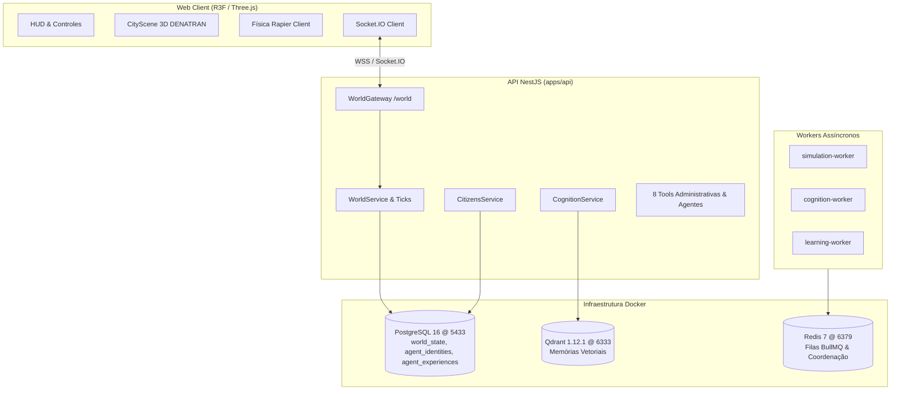

# Synapse City Engine

> **Ambiente Virtual 3D Persistente Habitado por Agentes de IA Humanizados**  
> Arquitetura baseada em Servidor Autoritativo, Memória Híbrida (Relacional + Vetorial) e Renderização WebGL/WebXR.

---

## 🏛️ Visão Geral da Arquitetura

O Synapse City Engine é estruturado em um monorepo gerenciado por **Nx** e **Turborepo**, separando claramente a renderização client-side da cognição e persistência autoritativa server-side:



Para mais detalhes, consulte [ARCHITECTURE.md](docs/architecture/ARCHITECTURE.md), [SKILL.md](SKILL.md) e o backlog de execução em [task.md](task.md).

---

## 📋 Pré-requisitos

- **Node.js**: Versão `>= 20.18.0` (recomendado: 22 LTS)
- **NPM**: Versão `>= 10.0.0`
- **Docker & Docker Compose**: Para provisionar PostgreSQL, Qdrant e Redis

---

## 🚀 Setup Rápido em Menos de 15 Minutos

### 1. Clonar e Instalar Dependências
```bash
git clone git@github.com:zaidohdevdan/cidade-virtual.git
cd cidade-virtual
npm install
```

### 2. Subir Serviços de Infraestrutura (Docker)
```bash
# Inicia PostgreSQL (5433), Qdrant (6333) e Redis (6379)
npm run docker:up
```

Para verificar a saúde dos containers:
```bash
docker compose -f infrastructure/docker/docker-compose.yml ps
```

### 3. Executar em Modo de Desenvolvimento
```bash
# Sobe a API (NestJS na porta 3001) e o Web Client (Vite na porta 3000) em paralelo
npm run dev
```

- **Cliente 3D da Cidade**: [http://localhost:3000](http://localhost:3000)
- **API NestJS (Swagger/Health)**: [http://localhost:3001](http://localhost:3001)

---

## 🛠️ Comandos Principais do Monorepo

| Comando | Descrição |
|---|---|
| `npm run dev` | Executa API e Web Client concorrentemente |
| `npm run dev:api` | Executa apenas o backend NestJS |
| `npm run dev:web` | Executa apenas o frontend Web Client |
| `npm run docker:up` | Sobe PostgreSQL, Qdrant e Redis via docker compose |
| `npm run docker:down` | Desliga os containers de infraestrutura |
| `npm run typecheck` | Validação estática de tipos TypeScript no monorepo inteiro |
| `npm run test` | Executa a suíte de testes unitários e de integração via Vitest |
| `npm run check:schema-drift` | Verifica paridade exata entre `init.sql`, schema Drizzle e `@cidade-virtual/types` |
| `npm run build` | Compilação de todos os packages e apps |

---

## 🧪 Testes e Validação Contínua

Para executar os testes de integração do banco e integridade do mundo:
```bash
npx vitest run tests/integration/persistence.test.ts
```

Para verificar drift de schema entre SQL e TypeScript:
```bash
npm run check:schema-drift
```

---

## 📂 Estrutura do Projeto

```
cidade-virtual/
├── apps/
│   ├── api/                 # Backend NestJS, Gateway Socket.IO e Tools
│   ├── web-client/          # Frontend 3D R3F/Three.js com física e HUD
│   ├── admin/               # Painel Administrativo God Mode (Vite)
│   ├── cognition-worker/    # Worker assíncrono para ciclos cognitivos
│   ├── simulation-worker/   # Worker para simulação autoritativa
│   └── learning-worker/     # Worker para consolidação passiva de memórias
├── packages/
│   ├── types/               # Contratos e tipos compartilhados
│   ├── persistence/         # Drizzle ORM, schema e repositórios PostgreSQL
│   ├── memory/              # Serviço de memória vetorial Qdrant
│   ├── agent-cognition/     # CognitiveCycleManager e raciocínio contextual
│   ├── world-engine/        # Gerenciamento de estado espacial e navegação
│   └── ...
├── infrastructure/
│   ├── database/init.sql    # DDL inicial do PostgreSQL
│   └── docker/              # docker-compose.yml (Postgres, Qdrant, Redis)
├── task.md                  # Backlog canônico consolidado
└── worklog.md               # Diário de bordo e histórico de execuções
```
